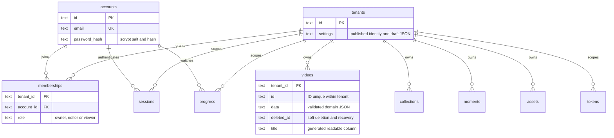

# Fictional development database

`mypremiereplus.db` is the actual SQLite database used by the application in its default local demo configuration. It is a working database, so account, profile and metadata edits made here are read by the application on its next request. It is not an export that must be imported into another database.

`seed.db` is the separate, pristine fictional fixture intended for version control. On first setup, the app copies it only if `mypremiereplus.db` does not exist, then checks migrations. It never copies over an existing working file. If the seed file is absent, the same fictional seed functions initialise a fresh working database. Custom `DB_PATH` / `DATA_DIRECTORY` selections and `DEMO_MODE=false` do not copy this fixture.

Starting with an existing working file applies versioned migrations and skips fixture reseeding. Names, metadata and deliberately removed profiles or channels remain as edited.

The editable working database and its journals are local runtime state and should be ignored by Git. They can contain account edits, password hashes, active session/code hashes and viewing activity. Keep them private. Rebuilding `seed.db` never opens or changes the working database.

The seed's three owner accounts are `demo@example.test`, `other@example.test` and `third@example.test`. Their password is `premiere-demo`. They own separate archives with three viewing profiles each. `viewer@example.test` is an additional viewer account in the first archive for checking permissions. These credentials and the pristine seed content are deliberately fictional; local working edits are separate.

The fixture includes linked archives, accounts, memberships, profiles, videos, collections, saved moments, text stories, synthetic captions, chapters, three channels, a shared programme and a future premiere per archive. The stock-media configuration partitions ten distinct approved external clips between the archives as four, three and three sources, rotating each set across that archive's eight film records. Profiles share their archive's library and keep separate watchlists/progress; all three archives live in one database. The original supplied clip remains an optional fallback. See [MEDIA.md](MEDIA.md) for review status and explicit migration steps.

The Family Channel includes the approved library; Our Summers selects holiday films; Celebration TV selects celebration films. Pristine profile-specific watchlists demonstrate the profile relationships without altering existing working lists. Captions explicitly identify themselves as synthetic examples; they do not claim to transcribe the stock footage. The future premieres use a date in 2099 so the scheduled-release workflow can be inspected and edited.

The pristine fixture has all 24 films connected to the ten sources. The existing working database received the reviewed `stock-v1` migration for 22 unchanged films; two edited films retain their exact original rows and fallback source. All ten sources are represented in the working database. This preserves local edits while keeping the distributable seed reproducible. See the [applied dataset checks](MEDIA.md#applied-dataset).

Each archive also has a fictional Family Cinema subscription at EUR 14.99 per month, a dummy card display ending 4242, a fictional billing address and three demonstration invoices. There is no payment provider or actual charge. Only the archive owner can retrieve or edit billing details and download these fictional invoices. Other members can see the plan summary. Account name and email edits affect the signed-in account only; a viewing profile cannot change its role. Archive palette and font choices use ten supported presets each and remain drafts until published.

`schema.sql` describes the physical domain tables; [SCHEMA.md](SCHEMA.md) explains their relationships, the compatibility view, browser code sign-in and cloud provider boundaries. `datasets.json` is sanitised readable metadata generated from the fresh seed, not an export of the working database. It excludes password hashes, sessions, pairing codes, tokens, private files and runtime audit history. The working SQLite database remains the application's source of truth; editing the JSON does not change live data.

The standalone [schema-map.svg](schema-map.svg) groups the physical tables and highlights their main links. It uses local SVG shapes and system fonts; no external visual assets are loaded.

## Run and inspect

From the repository root:

```powershell
npm install
npm run setup
npm run dev
```

Open the sign-in screen to see the current account directory. It rereads SQLite automatically every five seconds without restarting the server. The directory includes newly inserted accounts even before a membership exists; those entries say they still need an archive membership. The directory returns names, emails and archive memberships only. It runs only for this known fictional fixture on a loopback host with local demo mode enabled. Setting `DB_PATH` or `DATA_DIRECTORY` selects another database and disables the directory unless a test explicitly opts in. `DEMO_MODE=false` disables demo seeding, authentication and this directory.

Use a SQLite client to open `demo-data/mypremiereplus.db` and run the examples in `examples.sql`. While the app runs, SQLite may have a `-wal` file containing committed changes. Keep SQLite's database and journals together when making a private backup; do not copy the database by itself while a connection is writing. The distributable fixture is built independently from fresh fictional data.

File uploads remain in `.local/assets/`; no uploaded private files are bundled in this fixture. The previous `.local/archive.sqlite` database is preserved and can be selected explicitly with `DB_PATH` if needed.

## Add a fictional account

This helper hashes the known dummy password and inserts the linked account without resetting existing data:

```powershell
npx tsx scripts/demo-data.ts add-account --email taylor@example.test --name "Taylor Demo" --archive demo --role viewer
```

Omit `--archive` to demonstrate an account row awaiting membership. The SQL examples show the equivalent row inserts. For a different dummy password, set `DEMO_ACCOUNT_PASSWORD` in the command's environment; it is never printed. Do not put real identities or credentials in this checked-in dataset.

An account is an authenticated person. A membership grants access to an archive and sets the role. A viewing profile personalises playback within an archive and never grants permission. Inserting an account alone makes it appear in the local demo directory but deliberately does not grant access to any videos.

## Relationships



Physical `videos`, `collections`, `moments`, `profiles` and other domain tables hold the data. `records` is a read/write compatibility view over those tables. Video `collectionIds` are represented in `video_collections`. Moments, stories, captions, chapters and premieres refer to an original video with tenant-scoped foreign keys. Programmes contain video and moment relationships, a host account and viewing-profile IDs. The API validates fields and audiences before writes; manual SQL should also preserve valid clip boundaries and enable foreign keys. See [SCHEMA.md](SCHEMA.md) for the complete diagram and table list.

The SQL tables enforce tenant and membership foreign keys. Application queries additionally require an authenticated membership and tenant-scoped object lookups. The local directory is a deliberately limited demo convenience, not a production identity service.

## Rebuilding the pristine seed

Normal setup never replaces an existing working database. To explicitly regenerate the distributable fixture, run:

```powershell
npx tsx scripts/build-seed.ts
```

The helper creates an isolated temporary database, applies migrations, runs the fictional seed functions, checks integrity and foreign keys, confirms all runtime tables are empty, checkpoints it and atomically replaces only `seed.db`. It also rebuilds sanitised seed metadata and the schema export. It does not clone or open `mypremiereplus.db`, so current edits and login sessions remain intact. The four known dummy password hashes are intentional fixture data; no working auth state is copied.

The legacy `scripts/demo-data.ts` helper adds fictional accounts to the working database and no longer exports it into `datasets.json`. Its explicit `--clean-runtime` maintenance flag affects the working database only and should be used only after stopping its API when that cleanup is intended. It is not required to create the clean seed. Never commit private uploads, the working database or its journals.
