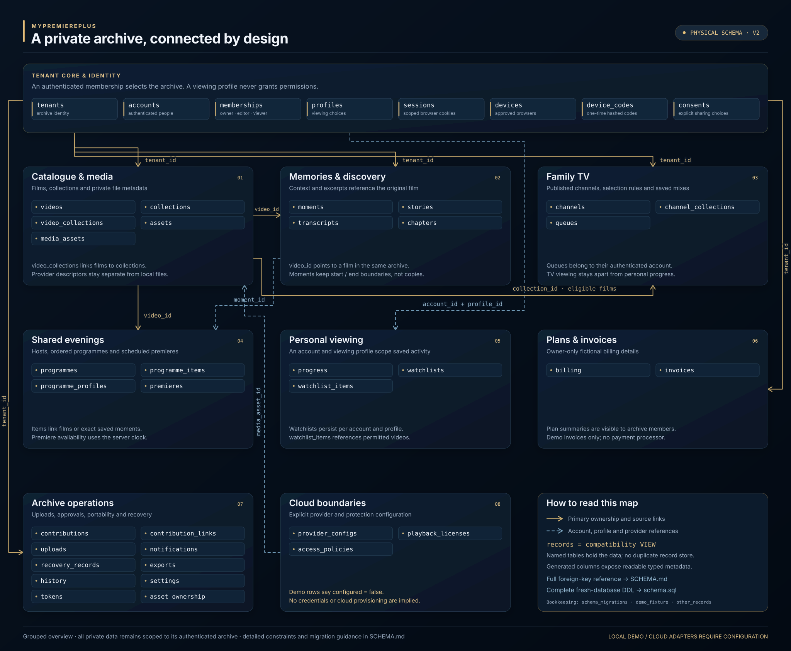
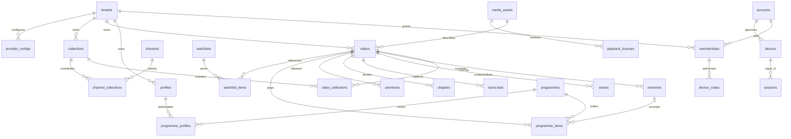

# Physical domain schema

Open [schema-map.svg](schema-map.svg) for a standalone, zoomable overview. The detailed foreign-key diagram below remains the full relationship reference.

Migration `0002_domain_tables.sql` replaces the original generic `records` table with physical domain tables. `records` remains a backwards-compatible SQL view with insert, update and delete triggers. It does not keep a second copy of the data. The application writes directly to the physical tables and reads the view plus the relationship tables.

`seed.db` contains the clean fictional version of this schema. `mypremiereplus.db` is the separate editable runtime database. Default local setup copies the seed only when the working file is missing; it never replaces an existing file or a custom database selection. `datasets.json` documents the sanitised seed content and is not the authority for current working data. Rebuilding the seed uses fresh isolated seed functions, never a copy of the live database.

Each domain table has `id`, `tenant_id`, `data`, `created_at`, `updated_at` and `deleted_at`. The JSON `data` column holds the editable domain object. Generated columns expose useful typed fields such as a video's title, recording year and duration; a moment's original video and time boundaries; and a premiere's release time. Generated columns are read-only. Edit their corresponding JSON properties with `json_set`, or use the application's API.

The physical tables are:

| Area                          | Tables                                                                                              |
| ----------------------------- | --------------------------------------------------------------------------------------------------- |
| Identity                      | `tenants`, `accounts`, `memberships`, `profiles`, `sessions`, `devices`, `device_codes`, `consents` |
| Films and collections         | `videos`, `collections`, `video_collections`, `assets`, `media_assets`                              |
| Memories and discovery        | `moments`, `stories`, `transcripts`, `chapters`                                                     |
| Family TV                     | `channels`, `channel_collections`, `queues`                                                         |
| Shared evenings               | `programmes`, `programme_items`, `programme_profiles`, `premieres`                                  |
| Contributions and uploads     | `contributions`, `contribution_links`, `uploads`, `asset_ownership`, `tokens`                       |
| Personal viewing              | `progress`, `watchlists`, `watchlist_items`                                                         |
| Archive management            | `settings`, `notifications`, `recovery_records`, `exports`, `history`                               |
| Plans and provider boundaries | `billing`, `invoices`, `provider_configs`, `playback_licenses`, `access_policies`                   |

`other_records` preserves any unrecognised legacy resource during migration. Existing application resources use the named tables above.

## Relationships and direct SQL

Tenant foreign keys scope every archive-owned table. Composite foreign keys ensure that moments, stories, captions, chapters, premieres, programmes and collection relationships refer to objects in the same archive. Programme items that use a saved moment also reference that moment's original source video. Soft deletion leaves relationships available for recovery; permanent deletion cascades the corresponding dependent rows where appropriate.

Video and channel collection arrays, programme items and participants, and watchlist videos are maintained in their relationship tables when their parent JSON changes. The application reads those tables when constructing its responses, so directly inserted or removed relationship rows are visible on the next request. Other metadata is read directly from the domain table. Backend authorisation continues to validate the authenticated membership, current audience, publication state and source access; database foreign keys supplement those checks.

Use `examples.sql` for both physical-table and compatibility-view examples. Manual SQL can bypass the API's field and visibility validation, although foreign keys still reject invalid cross-archive relationships when enabled. Always use `PRAGMA foreign_keys=ON` in an external SQLite client.

## Browser code sign-in

This is a browser feature and does not introduce a native TV application.

`POST /api/device/start` creates a pending request with a 256-bit device secret, an eight-character approval code, a five-minute server-controlled expiry and a three-second polling interval. The requesting browser holds the secret; the database stores only hashes. A signed-in member approves the visible code through `POST /api/device/approve`. The server binds that member's actual account and archive. Changing viewing profiles or submitting another tenant/account/role in the request cannot change that binding.

The requesting browser polls `/api/device/poll`. Pending, expired and consumed requests cannot sign in. Approval is consumed atomically once, then the server creates the scoped HttpOnly session cookie. A signed-in phone browser can alternatively create a one-time code at `/api/device/code`; the other browser redeems it at `/api/device/redeem`. Both flows check current membership and preserve its current role. Attempts are limited, and linked devices can be listed and revoked by their own account. These local demo identities still need a configured production identity provider before public operation.

Device secrets and approval codes do not appear in the viewer bootstrap, account directory, metadata export or readable dataset snapshot. Pairing requests and linked-device activity are runtime data, so the distributable fixture does not need populated code rows.

## Cloud provider boundaries

`provider_configs` contains explicit `configured=false` demo rows for customer Cloudflare Stream, private R2 files, optional image generation and optional transcription. No credentials are stored in those rows. `media_assets` describes approved external stock sources and the optional original supplied sample, including source/author/licence evidence. The stock dataset partitions ten distinct clips between the three tenant archives as four, three and three, while profiles share their archive's library and maintain account/profile preferences. Existing working watchlists are not changed by the source migration.

`playback_licenses` retains the original public-demo exception; customer media still requires a configured protected playback adapter. A public stock URL is returned only from the exact central allowlist after film access checks. `access_policies` documents the demo boundary while real current access remains enforced by memberships and per-resource visibility. `consents` starts with private-image AI sharing disabled. Media migration settings record `stock-v1`, its manifest fingerprint and applied/skipped seed-film IDs without changing the physical schema version.

The server has separate adapters for private R2 storage and signed Cloudflare Stream playback/direct upload. The Node/SQLite local server does not provision or deploy those services. Production requires configured identity, D1/R2/Stream bindings, secure signing configuration and provider-specific integration verification. Local uploads remain private files under `.local/assets/`. The supplied public sample does not demonstrate protection of actual customer video.

## Applying the migration safely

The application records applied versions in `schema_migrations`. A fresh installation applies both migrations; an existing installation applies version 2 once in a transaction. Existing records, drafts, soft-deletion state and timestamps are copied into their domain tables. Unknown resource kinds are preserved. A failure rolls back the migration.

Stop the old API and back up the active SQLite database, including its journals, before upgrading. An old running process must not continue writing after its generic table becomes a view. Start the updated API after the upgrade. No clean fixture should be restored over a working archive to perform this migration.

`schema.sql` is a complete schema script for a fresh empty database. For an existing database, use the versioned migrations through the application's `Store`; do not rerun the combined fresh schema over it.
